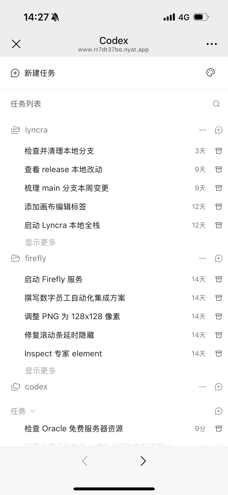
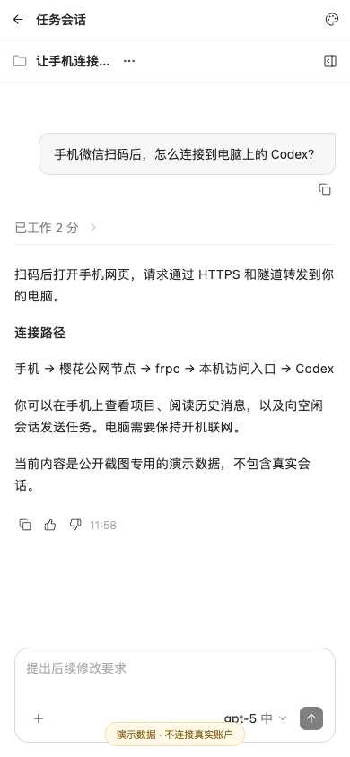
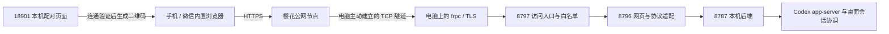

# Codex Mobile

**在手机微信中扫一扫，连接你电脑上的 Codex。**

离开电脑后，可以在手机网页里查看项目、阅读会话历史、查看图片，或给空闲会话发送任务。电脑继续运行 Codex；公网隧道负责连接手机与电脑。

这是个人开发的实验性适配项目，**不是 OpenAI 官方产品，也不是微信聊天机器人**。微信只负责扫码打开网页，不需要安装小程序或接入公众号。

## 界面效果

以下为实际页面在浏览器中的截图，使用独立演示数据，不包含个人会话。截图中的二维码无效。

| 电脑显示配对二维码 | 手机查看项目 | 手机阅读会话与输入任务 |
| --- | --- | --- |
|  |  |  |

## 当前可以做什么

| 能力 | 当前状态 |
| --- | --- |
| 微信扫码，打开 HTTPS 手机网页 | 已接通；修复了外部扫码跳转被来源校验误拦的问题 |
| 查看本机项目、任务列表与历史消息 | 已接通 |
| 阅读历史图片与工具执行记录 | 已接通，支持的内容以适配层为准 |
| 点击“新建任务”，进入输入界面 | 已接通；返回首页后可再次进入，发送前不创建会话 |
| 新建任务、向空闲会话发送消息 | 已接通，要求电脑端 Codex 在线、模型与账号可用 |
| 在会话内选择模型和思考力度 | 已接通，选项来自本机 Codex |
| 停止任务、审批、运行中追加指令 | 不作为当前发布版本的完整支持能力 |
| 归档 | 有后端适配，但原界面的确认流程未完整验收 |
| 重启、睡眠恢复、跨夜稳定性 | 尚未完整实机验收 |

本文的“已接通”描述当前开发环境的结果，不代表所有 Codex 版本、手机或网络都已验证。

## 当前框架



- **Node.js 后端**：调用本机 Codex CLI 的 `app-server`，并与同一用户的桌面会话协调服务连接。
- **手机界面**：复用 ZCode 3.16.3 的网页界面，通过兼容补丁和协议适配显示 Codex 数据。它不会调用 ZCode 的模型服务。
- **连接入口**：限制可访问的路径、方法、Host 与 Origin，转发 HTTP 和 WebSocket。
- **二维码**：包含公网地址和配对凭据。配对后使用会话 Cookie；二维码必须私下保管。
- **状态检测**：必须同时通过 HTTPS、实例身份和 WebSocket 消息往返验证，才显示可用二维码。

更详细的职责与数据流见 [架构说明](docs/architecture.md)。

## 中转服务：当前使用樱花

**目前验证通过并提供进程管理的是 SakuraFrp（樱花内网穿透）**：免费 TCP 隧道 + 免费 `nyat.app` 子域名 + 平台提供的 SSL 证书。

客户端在电脑上主动建立连接，无需给电脑开放公网入站端口。TLS 在本机 frpc 处理，然后转给本机 HTTP 服务。聊天由电脑端 Codex 执行；模型请求仍遵循电脑上的 Codex 配置。隧道是数据路径的一部分，不应当把它理解为不接触流量的文件存储。

2026-10-26 官方公布的普通用户额度为 **2 条隧道、10 Mibps 限速、每月 5 GiB 流量**，签到可增加流量；以[樱花官网](https://www.natfrp.com/)当期规则为准。我们实际配置时，创建隧道和免费域名功能都要求完成实名认证。实名认证由使用者在平台上自行处理，本项目不收集身份资料。

选择 TCP 隧道并启用自动 HTTPS、绑定免费子域名后，访问地址通常带一个高位端口。大陆 HTTP(S) 建站隧道还有备案域名要求，不能把不同隧道类型的要求混为一谈。

**其他免费方案是候选，不等于本项目已兼容。** Cloudflare Quick Tunnel、localhost.run、ngrok、OpenFrp 等的限制、接入条件与验证边界见 [中转方案对比](docs/tunnels.md)。本项目保留历史 cpolar 连接模块，但公开版启动器当前只管理樱花客户端。

## 环境要求

- **macOS**：当前只完成 Mac 环境开发与验证。Windows / Linux 尚未支持安装和桌面会话连接。
- **Node.js 24+、Python 3**，以及已经登录、可正常使用的 Codex 桌面环境。
- 本机 Codex CLI：默认查找桌面应用内置路径，也可在配置中指定 `codexBin`。
- **ZCode 3.16.3 本地安装包**：用于导入版本匹配的 RPC 运行时；不需要启动或登录 ZCode。网页资源来自官方公开地址。
- 一个已配置好的樱花免费账号、隧道和域名，以及对应平台客户端 `frpc`。

桌面会话协调接口属于兼容性依赖，Codex 或 ZCode 升级可能导致本项目失效。不要把不同版本的前端和协议运行时混用。

## 安装与运行

```bash
git clone https://github.com/owenweng0101/codex-mobile.git
cd codex-mobile
npm ci

# 从本机 ZCode 3.16.3 导入匹配的 RPC 运行时，并下载官方网页资源。
# 导入的第三方构建文件保留在本地，不进入 Git。
npm run prepare:ui -- --zcode-app /Applications/ZCode.app

cp examples/config.example.json config.local.json
```

然后完成以下配置：

1. 在樱花控制台创建 **TCP** 隧道，本地 IP 为 `127.0.0.1`，本地端口为 **8797**，远程端口按控制台分配。
2. 按[官方子域绑定文档](https://doc.natfrp.com/bestpractice/domain-bind.html)绑定免费域名，将自动 HTTPS 设置为“自动”。
3. 从控制台复制你自己的 frpc 配置，保存在仓库外的私有文件中。可参考 [配置模板](examples/frpc.example.ini)，但不能直接使用模板中的假密钥。
4. 编辑 `config.local.json`，填写 `publicOrigin`（含远程端口）、客户端 `binary` 和私有 `configPath` 的绝对路径。必要时填写 `codexBin` 与 `workspaceRoot`。
5. 保护配置：`chmod 600 /你的私有目录/frpc.ini`。不要将密钥提交到 Git 或发给别人。

```bash
# 推荐先单独验证网络，不读取 Codex 会话
npm start -- --probe
# 在电脑打开 http://127.0.0.1:18901/，手机扫码验证 HTTPS 和消息往返
# 完成后按 Ctrl-C 停止

# 再启动完整服务
npm start
```

在电脑打开 **http://127.0.0.1:18901/**，等待二维码出现，用微信“扫一扫”打开。终端需保持运行，电脑需开机联网。按 `Ctrl-C` 会停止本次启动的进程。

启动器会检查端口占用，**不会停止已有服务**。若你已经安装旧版本，需要先自行停止旧服务，再运行这份独立项目。

公开启动器独立提供配对页面，不依赖作者个人使用的模型网关，也不修改模型配置。

## 演示、测试与开发

完整附件解析与测试需要额外的 Python 包。可以使用独立虚拟环境，随后启动器会继承 `CODEX_MOBILE_PYTHON`：

```bash
python3 -m venv .venv
.venv/bin/pip install -r requirements-dev.txt
export CODEX_MOBILE_PYTHON="$PWD/.venv/bin/python3"
```

`pypdf`、`openpyxl` 用于 PDF / XLSX 附件解析；`reportlab`、`python-docx` 用于测试生成样本。只查看会话或发送文字时不需要这些额外包。

```bash
npm test              # 需要先 prepare:ui；不向真实 Codex 发送任务
node scripts/demo.mjs # 仅演示数据，不读取 ~/.codex，不调用模型
```

演示配对页为 `http://127.0.0.1:19091/`，界面为 `http://127.0.0.1:19096/`。演示模式不执行发送等写操作，不能用来证明真实模型调用成功。

## 安全与已知限制

二维码、配对链接和客户端密钥都是凭据。不要将有效二维码放进公开文档。只把公网隧道指向 `8797`，不要直接暴露 `8787`、`8796` 或配对面板。

项目允许微信等外部入口正常打开首页，但不会因此放开跨站 API 调用。前后端仍保留配对验证、同源检查和明确的访问白名单。[安全说明](SECURITY.md)列出了边界与注意事项。

当前是实验性首版，尚未完成全新 Mac 的完整安装、真实睡眠恢复和所有手机环境验证。安装脚本不申请平台权限、不代办实名、不购买中转套餐。

## 来源与许可

本仓库的适配代码使用 **Apache-2.0**。手机界面及部分协议来自 [ZCode](https://github.com/zai-org/ZCode)，本地准备脚本不将其完整构建产物再分发到本仓库。来源、导入范围和补丁机制见 [THIRD_PARTY.md](THIRD_PARTY.md) 与 [NOTICE](NOTICE)。

Codex、OpenAI、微信、ZCode、樱花等名称用于描述兼容对象和服务来源，不表示官方合作或背书。
