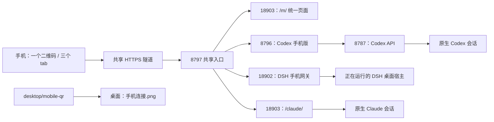

# 统一手机入口架构

一个用户入口不意味着删除协议适配器。8787/8796/8797/18902/18903 都承载当前链路，仍需保留；旧 18901 扫码网页及旧双码不是运行依赖。二维码任务只读取私有控制 socket 和回环状态，不新增 HTTP 管理端口。

Codex 后端、适配器和连接程序按既有安装方式部署到 Application Support。DSH、Claude 及 QR 的维护源代码来自同一仓库。所有会话仍由各自原生桌面系统持有；不启动第二个共享数据库的 DSH 宿主。

公网入口检查 Host、Origin、路径和各模块认证。为了在统一页面承载同源 iframe，入口使用 SAMEORIGIN；不开放任意跨站嵌入。三个模块仍使用各自的鉴权状态。

旧模块文档的顶层 GET/HEAD 导航跳转到 `/m/#`，显式清掉旧 query 和继承的 fragment。内部 iframe 文档继续交给对应适配器。浏览器提供 `Sec-Fetch-Dest` 时只有 `iframe` 可进入模块文档；缺少该头的旧 WebView 使用 `hub_frame=1`，文档最前面的脚本仍会阻止顶层独立打开。marker 只用于呈现路由，不代表认证；不会把旧模块口令兑换成统一入口登录状态。直连适配器的旧文档也遵守相同规则。

DSH 只服务已审核的固定前端及显式移动模块集合。Codex 完整网页与 RPC 构建在本机准备；它们不是可以随本仓库再发布的编译产物。第三方 Marked、PDF.js 的代码与声明单独保留。

维护命令集中在根目录。默认停止和更新保留 Codex 后端；需要变更该后端时，先确认本项目持有的任务和终端已退出，再取得维护许可。不能用杀进程绕过维护保护。
